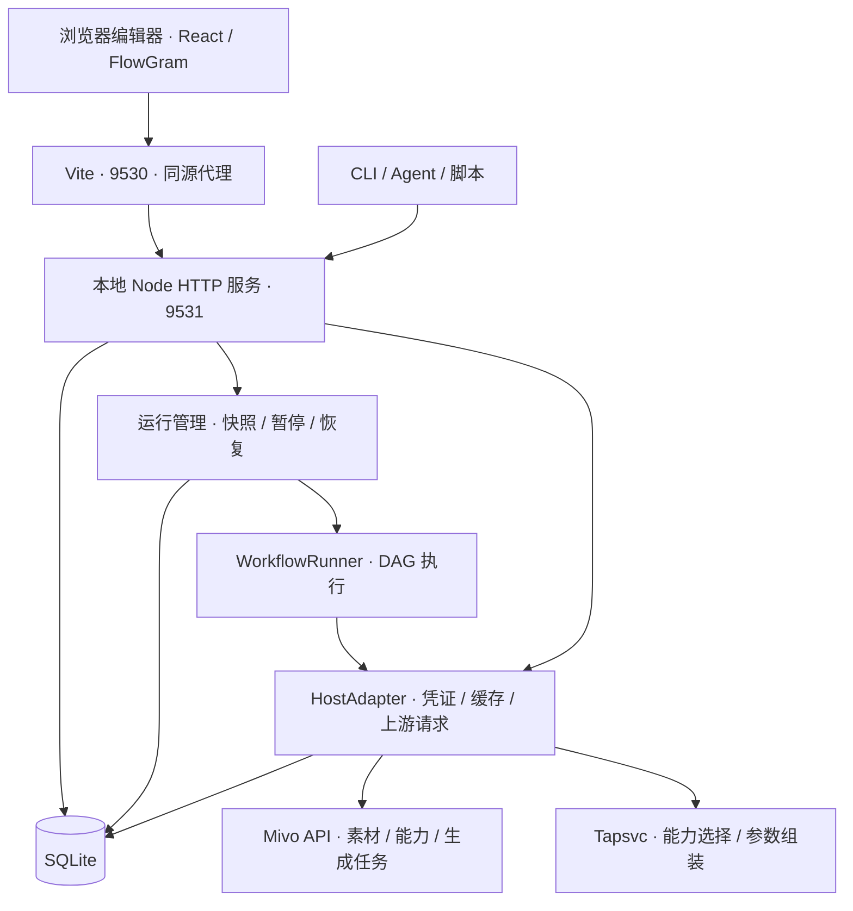

# Mivo Workflow

用可视化节点编排 Mivo 图片、视频、音频和 3D 生成任务，保存为可以反复运行的本地工作流。
你可以在浏览器里编辑，也可以通过 CLI 传入参数执行；两种方式使用同一个本地服务和数据库。

```sh
mivo-workflow run --workflow-id <工作流ID> \
  --字段1 '一只戴墨镜的猫' \
  --图片1 ./参考图.png
```

## 功能

- **可视化编排**：基于 FlowGram 的画布，支持开始、生成、条件分支和结束节点。
- **多种输入**：字符串、图片、视频、音频、模型；变量名支持中文。
- **能力选择与参数组装**：根据需求选择 Mivo 能力，生成请求参数，并按能力协议校验。
- **本地持久化**：SQLite 保存工作流、草稿历史、运行快照、配置、密钥和能力目录。
- **独立运行**：任务在 Node 服务中执行，关闭网页或停止 Vite 不会终止已提交的本地运行。
- **运行恢复**：保存节点进度和上游任务 ID，支持暂停和恢复，减少重复提交。
- **CLI 与脚本调用**：支持 JSON 输出、后台执行、状态查询和下载最终产出。

## 快速开始

### 1. 安装与启动

需要 **Node.js 22.13+** 和 pnpm。当前使用 Node 内置的 `node:sqlite`，无需单独安装数据库。

```sh
git clone https://github.com/maoxinxin-xd/mivo-workflow.git
cd mivo-workflow
pnpm install
pnpm dev
```

打开 <http://127.0.0.1:9530>。
Vite 启动时会检查本地服务，并在需要时自动启动独立的后台进程。

| 组件 | 默认地址 | 用途 |
| --- | --- | --- |
| 编辑器 / Vite | `http://127.0.0.1:9530` | 编辑、预览、设置和查看运行记录 |
| 本地 Node 服务 | `http://127.0.0.1:9531` | 存储、执行、凭证管理和上游接口适配 |
| 本地 Mivo 上游 | `http://127.0.0.1:8000` | 选择本地环境时使用的 Mivo API |

本仓库不会启动 Mivo 后端。使用本地环境时，需要已有可访问的 Mivo 服务；
也可以在编辑器设置中切换到测试或生产环境。

### 2. 配置连接

在底部工具栏打开“设置”，选择 API 环境并保存：

- **Mivo API Key**：用于访问能力目录、上传素材和提交生成任务，按环境保存。
- **Tapsvc API Key**：用于生成节点中的能力选择与参数组装。

保存 Mivo Key 时会同步能力目录。密钥保存在本地服务的 SQLite 中，浏览器只读取配置状态。
执行生成节点需要配置这两类 Key；只编辑工作流无需先配置。

### 3. 编辑并运行

1. 在开始节点添加变量，设置类型、名称和默认内容。
2. 在生成节点填写需求，通过 `@` 选择上游可引用的内容或素材。
3. 按需添加条件分支，在结束节点配置最终输出。
4. 点击运行，手动打开运行记录查看进度和结果。

工作流自动保存到数据库；菜单支持新建、导入 / 导出 JSON，以及复制运行命令。
JSON 导出的是工作流定义，不包含数据库中的 API Key，也不会打包媒体原文件。

## 命令行

### 安装本地命令

在项目目录中执行：

```sh
pnpm link --global
mivo-workflow --help
```

这是链接当前源码目录的本地命令，需要保留项目和已安装的依赖。
也可以不做全局链接，直接在项目中使用 `pnpm workflow ...`。

### 查找工作流与传入参数

```sh
mivo-workflow list
mivo-workflow show --workflow-id <工作流ID>

mivo-workflow run --workflow-id <工作流ID> \
  --字段1 '一只戴墨镜的猫' \
  --图片1 ./参考图.png \
  --output ./outputs
```

示例要求工作流的开始节点中存在 `字段1` 和 `图片1`。参数必须匹配变量名称。

| 输入类型 | CLI 接受的值 | 处理方式 |
| --- | --- | --- |
| 字符串 | 文本 | 直接作为本次输入 |
| 图片 / 视频 / 音频 / 模型 | 本地文件路径 | 校验文件类型，上传后将文件引用作为输入 |

未提供的变量沿用工作流默认值；未知变量报错。
相对路径按命令执行时所在目录解析。输入覆盖只影响本次运行，不修改工作流默认内容。

默认等待运行结束，进度写入标准错误，结果以 JSON 写入标准输出。
等待模式下，最终状态不是成功时退出码为 `1`。

### 后台运行、查询与恢复

```sh
# 提交后立即返回 runId
mivo-workflow run --workflow-id <工作流ID> --字段1 '内容' --detach

# 查看完整运行记录
mivo-workflow status --run-id <运行ID>

# 暂停本地执行
mivo-workflow stop --run-id <运行ID>

# 使用原工作流和输入快照恢复
mivo-workflow resume --run-id <运行ID>
```

`--detach` 返回后，本地服务继续执行；退出 CLI 不会主动暂停任务。
`stop` 暂停的是本地执行和轮询，**不会取消已经提交到 Mivo 的生成任务**。
恢复时会创建新的运行记录，并尽可能复用已完成节点及已有任务 ID。

### 参数参考

| 选项 | 适用命令 | 说明 |
| --- | --- | --- |
| `--workflow-id` | `show`、`run` | 工作流 ID，可通过 `list` 获取 |
| `--run-id` | `status`、`stop`、`resume` | 运行 ID |
| `--environment` | `run` | `local` / `test` / `production`，默认使用网页设置 |
| `--detach` | `run`、`resume` | 不等待运行结束 |
| `--output` | 等待模式的 `run`、`resume` | 成功后下载结束节点的媒体及 `result.json` |
| `--inputs-json` | `run` | 从 JSON 文件读取变量名到文本或本地路径的映射 |
| `--confirm-restart` | `run` | 确认存在待核实的任务时仍重新执行，可能产生重复任务 |

变量名包含空格或与 CLI 选项同名时，可使用 `inputs.json`：

```json
{
  "字段1": "一只戴墨镜的猫",
  "图片1": "./参考图.png"
}
```

```sh
mivo-workflow run --workflow-id <工作流ID> --inputs-json ./inputs.json
```

JSON 文件中的值必须是字符串。也可以同时传普通变量参数，同名时普通参数优先。

## 架构



### 组件职责

| 层 | 职责 | 主要入口 |
| --- | --- | --- |
| 编辑器 | 节点编辑、自动保存、素材预览、运行状态显示 | `src/App.tsx`、`src/editor.tsx` |
| CLI | 参数解析、本地文件上传、提交和查询运行、下载结果 | `server/cli.ts` |
| HTTP 服务 | 工作流、设置、运行和缓存 API，以及受限的上游代理 | `server/index.ts` |
| 运行管理 | 隔离每次运行、冻结输入、持久化进度、暂停和恢复 | `server/runs.ts` |
| 执行器 | 校验 DAG、调度节点、解析引用、处理条件分支和汇总结果 | `src/runtime.ts` |
| 上游适配 | 管理密钥与会话、刷新 Token、请求 Mivo / Tapsvc | `server/adapter.ts` |
| 数据层 | SQLite 表、事务、加密、草稿历史和缓存读写 | `server/database.ts` |

FlowGram 用于编辑器和图结构；实际运行由本项目的 `WorkflowRunner` 完成。
浏览器和 Node 通过 `src/host.ts` 的适配接口复用协议处理代码，运行时由 Node 注入服务端实现。

### 一次运行的过程

1. 编辑器或 CLI 向本地服务提交工作流 ID 和本次输入。
2. 服务校验工作流，生成独立的运行 ID，并保存工作流与输入快照。
3. 执行器按节点依赖调度 DAG；互不依赖的分支可以并行执行。
4. 生成节点读取能力目录和素材信息，由 Jev 选择能力，再由 `auto` 组装参数。
5. 本地代码按能力协议校验参数、绑定素材，通过 Mivo API 提交任务并轮询结果。
6. 节点状态、任务 ID 和输出随进度写入数据库；编辑器和 CLI 通过查询获得状态。

同一工作流、同一环境、同一账号同时只允许一个活跃运行。
编辑工作流不会改变已经创建的运行快照；恢复也使用原快照，不能同时更换输入。

### 持久化与媒体存储

| SQLite 表 | 内容 |
| --- | --- |
| `workflows` | 工作流定义 |
| `drafts` | 草稿历史，每个工作流最多保留 30 份草稿 |
| `runs` | 工作流 / 输入快照、节点状态、任务 ID 和输出引用 |
| `settings` | 当前环境、选中工作流和会话版本等设置 |
| `secrets` | 加密的 API Key 与会话凭证 |
| `capability_catalogs` | 按环境、账号和会话版本隔离的能力目录 |
| `cache` | 带过期时间的能力请求、资源解析和签名结果等缓存 |

数据库使用 WAL 和事务。浏览器保留内存镜像与短期预览缓存，持久化状态由本地服务管理。
首次打开新版编辑器时，会尝试迁移旧浏览器中的兼容工作流、凭证和可用运行记录；
只有收到存储成功确认后才清除对应旧数据。

**媒体原文件仍由 Mivo 文件服务保存**，数据库主要保存 `fileId`、文件名和相关元数据。
备份 SQLite 不等于备份媒体文件；需要保留最终产出时使用 `--output` 下载。

### 暂停与故障恢复的边界

- 关闭网页、停止 Vite 或退出 CLI：独立的 Node 服务仍可继续执行。
- Node 服务正常退出：尝试暂停活跃运行并保存状态。
- Node 服务异常退出：下次启动将遗留的运行中记录标为暂停，不自动重提任务。
- 恢复已有任务：复用记录中的上游任务 ID，继续查询其结果。
- 提交响应丢失：可能无法确认上游是否已经接单，需要先核实，再决定是否重新运行。

恢复机制不能保证跨本地数据库与远端 API 的“恰好一次”提交。
`--confirm-restart` 是显式允许重跑，不代表撤销或替换先前的远端任务。

## 本地数据、配置与服务管理

默认数据目录：

```text
~/.mivo-workflow/
├── workflow.sqlite       # 工作流、运行、设置、密钥和缓存
├── workflow.sqlite-wal   # SQLite 运行时可能存在的 WAL 文件
├── workflow.sqlite-shm   # SQLite 运行时可能存在的共享内存文件
├── secret.key            # 数据库凭证字段的加密密钥
└── server.log            # 自动启动的后台服务日志
```

密钥字段使用 AES-256-GCM 加密；数据目录权限为 `0700`，数据库与密钥文件权限为 `0600`。
`secret.key` 与数据库保存在同一台机器，加密不替代操作系统账号和文件权限保护。
本地 HTTP 服务只监听 `127.0.0.1`，并校验 Host / Origin；当前定位为单机使用。

### 环境变量

| 变量 | 默认值 | 含义 |
| --- | --- | --- |
| `MIVO_WORKFLOW_DATA_DIR` | `~/.mivo-workflow` | 数据库、加密密钥和后台日志目录 |
| `MIVO_WORKFLOW_PORT` | `9531` | 本地 Node 服务端口 |
| `MIVO_LOCAL_ENDPOINT` | `http://127.0.0.1:8000` | 本地环境的 Mivo 上游地址 |

配置示例：

```sh
export MIVO_WORKFLOW_DATA_DIR="$HOME/.mivo-workflow"
export MIVO_WORKFLOW_PORT=9531
export MIVO_LOCAL_ENDPOINT=http://127.0.0.1:8000
pnpm dev
```

Node 服务通过 `process.env` 读取配置，当前不会自动加载 `.env`；`.env.example` 用于说明变量。
编辑器与 CLI 应使用相同的服务端口。已运行的后台服务不会因更改环境变量而更新，需先停止再启动。

### 前台启动与重启

```sh
# 前台启动，日志输出到当前终端
pnpm service

# 或确保后台服务可用并打印地址
mivo-workflow serve

# 查看后台日志与监听进程
tail -f ~/.mivo-workflow/server.log
lsof -nP -iTCP:9531 -sTCP:LISTEN
```

前台服务可以通过 `Ctrl+C` 停止。后台服务可在核对监听进程后对其发送 `SIGTERM`：

```sh
kill -TERM <确认后的服务PID>
mivo-workflow serve
```

服务代码没有热更新，修改 `server/` 或服务端复用的运行代码后需要重启 Node 服务。
若已有服务占用同一端口，不要重复执行 `pnpm service`；编辑器和 CLI 会复用已有服务。

### 备份与恢复

暂停运行并停止本地 Node 服务后，备份整个数据目录；恢复时同样先停止服务，
再还原目录或通过 `MIVO_WORKFLOW_DATA_DIR` 指向备份位置。

必须同时保留 **`workflow.sqlite` 和 `secret.key`**。
丢失 `secret.key` 后无法解密已保存的凭证，需要重新配置 Key。
运行中的 SQLite 可能有未合并的 WAL 数据，不要在运行时只复制主数据库文件作为完整备份。

## 本地 API

编辑器和 CLI 使用同一套接口。下表路径相对于 `http://127.0.0.1:9531`：

| 方法 | 路径 | 用途 |
| --- | --- | --- |
| `GET` | `/local-api/health` | 服务健康检查 |
| `GET` | `/local-api/library` | 工作流列表和草稿库 |
| `GET` | `/local-api/workflows/:id` | 工作流定义 |
| `POST` | `/local-api/workflows` | 保存工作流，请求体含 `workflow` |
| `GET` / `PUT` | `/local-api/settings` | 读取公开配置状态 / 切换环境 |
| `GET` / `POST` | `/local-api/runs` | 查询运行 / 创建运行 |
| `GET` | `/local-api/runs/:id` | 读取运行记录 |
| `POST` | `/local-api/runs/:id/stop` | 暂停运行 |
| `POST` | `/local-api/runs/:id/resume` | 从原快照恢复 |

直接提交字符串输入：

```sh
curl http://127.0.0.1:9531/local-api/runs \
  -H 'Content-Type: application/json' \
  -d '{"workflowId":"实际工作流ID","inputs":{"字段1":"一只戴墨镜的猫"}}'
```

HTTP 的媒体输入需要传已上传的素材对象；本地文件上传和路径转换由 CLI 负责。
`/mivo/...` 和 `/llm/...` 提供限定路径的上游适配，不是任意 URL 的通用代理。
这些接口服务于当前编辑器与 CLI，尚未承诺为独立、长期兼容的公共 SDK 契约。

## 目录结构

```text
bin/                         CLI 启动入口
server/
  bootstrap.ts               检查并启动独立后台服务
  index.ts                   HTTP 路由和服务生命周期
  cli.ts                     命令解析、上传和结果下载
  runs.ts                    运行管理与恢复
  database.ts                SQLite 和凭证加密
  adapter.ts                 Node 环境的上游适配
src/
  App.tsx                    主界面和运行状态同步
  editor.tsx                 FlowGram 编辑器集成
  inspector.tsx              节点属性面板
  InputFields.tsx            开始节点的自定义变量
  model.ts                   工作流、节点、变量和运行数据类型
  workflow-validation.ts     工作流格式校验
  runtime.ts                 DAG 执行器
  run-state.ts               节点签名与快照协调
  generation.ts              能力选择和参数生成
  generation-protocol.ts     能力协议校验与请求组装
  api.ts                     Mivo 客户端
  host.ts                    浏览器 / Node 共用代码的适配接口
  storage.ts                 前端工作流镜像及迁移
  capability-cache.ts        能力目录缓存
  resource-cache.ts          资源解析与预览缓存
proxy/server.ts              本地服务的兼容启动入口
vite.config.ts               开发服务器、服务启动和同源代理
```

技术栈：React 18、TypeScript、Vite 6、FlowGram、Semi UI、Lucide、Tailwind CSS 4、
Node.js 和 SQLite。图标统一使用 Lucide。

## 当前边界与后续设计

当前工作流格式为 `mivo-flowgram` / `version: 3`，不兼容的旧定义会在迁移时过滤。
服务重启后需要显式恢复运行；目前没有开机自启、分布式队列或多用户服务部署能力。

面向 Agent 的工作流描述、参数说明、独立固定常量区、预设素材选择与受限选项，
目前仍处于设计讨论阶段，尚未实现。当前 `show` 返回完整工作流定义；
CLI 使用开始节点的现有变量和默认值执行。

## 开发约定

- GitHub 仓库为 `maoxinxin-xd/mivo-workflow`，使用 `maoxinxin-xd` 账号。
- 前端修改后不主动运行构建、类型检查或 lint；没有明确要求时不新增测试。
- 提交前执行 `git diff --check`，新增代码行宽不超过 100 字符。
- 不提交数据库、密钥、运行缓存、依赖目录或 `.env`。
- FlowGram 编辑器集成涉及的第三方许可声明见 [NOTICE](NOTICE)。
